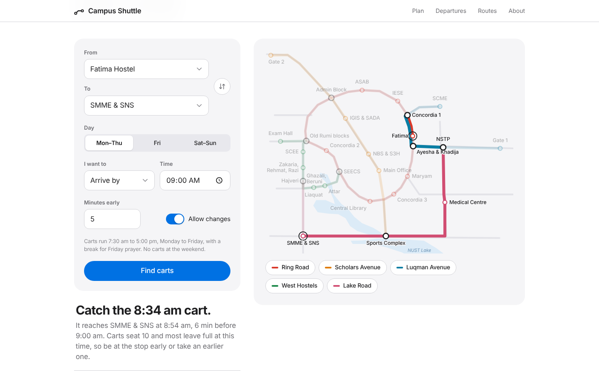
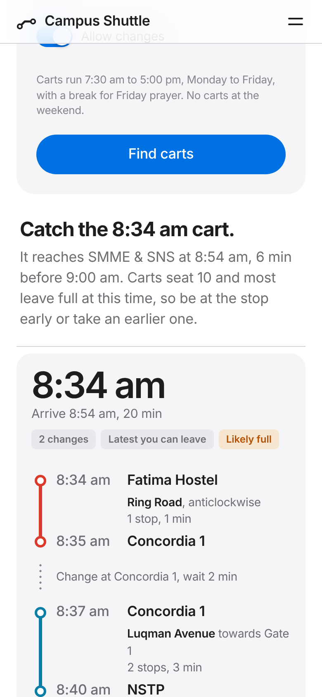
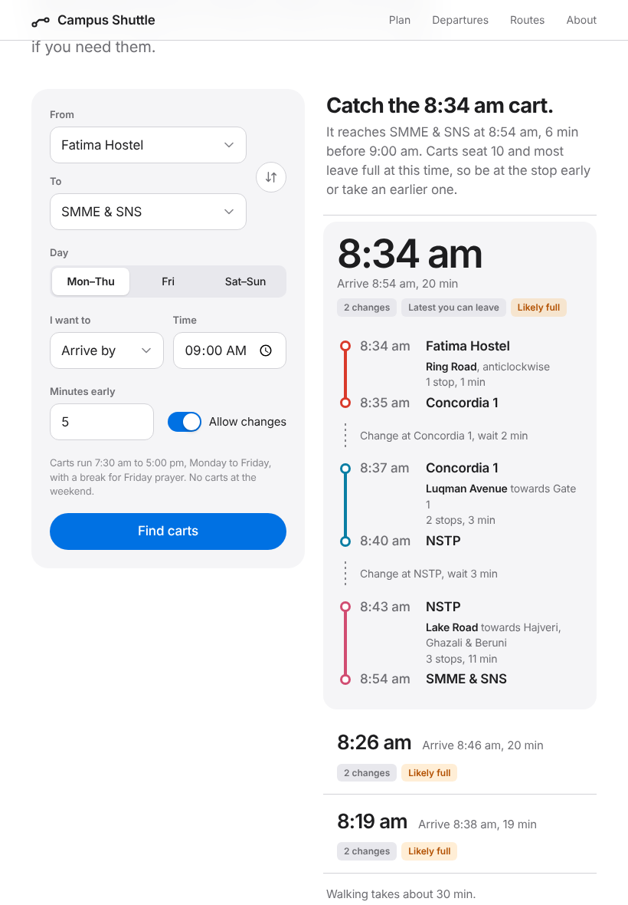
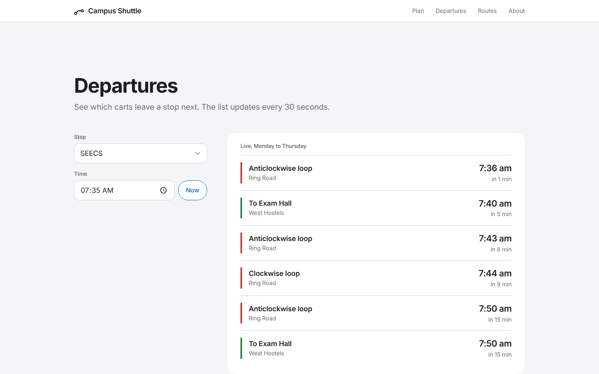
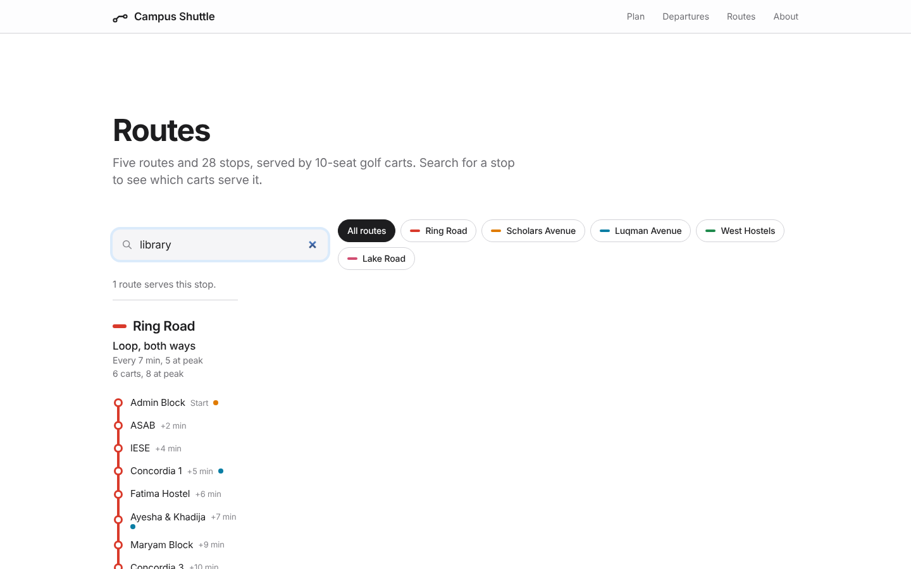
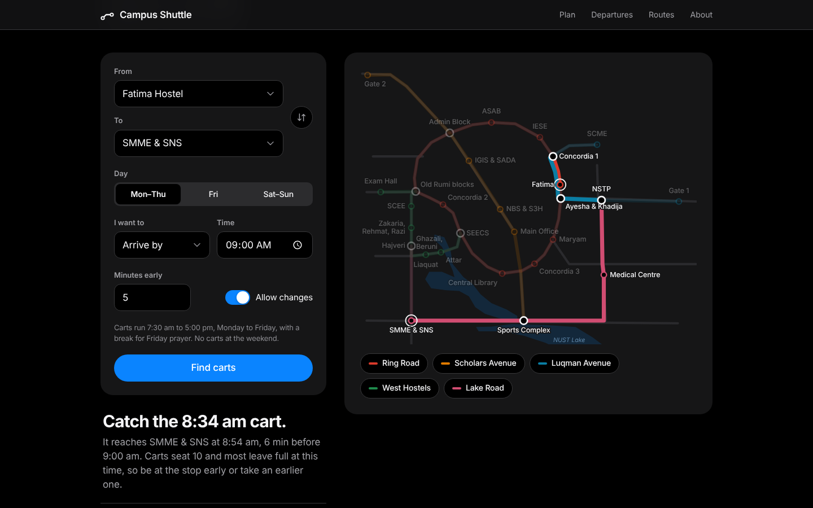

# Campus Shuttle Route Planner

A website that tells a NUST H‑12 student which shuttle to catch to reach class on time.

**Live app:** https://ra-1020.github.io/Campus-Shuttle-Route-Planner/



## What it does
- **Plan a trip.** Pick a start, a destination, the day, and "Arrive by" or "Leave after" a time. The planner finds the latest cart that still gets you there, offers two more options, and draws the ride on the map. Trips with up to two changes are included unless you turn changes off.
- **Seat warnings at peak times.** Carts seat 10. Between 8 and 9 am, at the 1–2 pm lunch break and around 5 pm, rides going with the crowd are marked *Likely full*, and the planner points to a safer, earlier cart.
- **Know when it won't work.** If nothing arrives in time, it says how late the earliest cart would be and when to leave on foot instead. It also covers Sundays, the Friday prayer break, the time after the last cart, and walking being quicker than riding.
- **See departures from a stop.** A live list of the next six carts from any stop, refreshed every 30 seconds.
- **Browse routes.** Search stops, filter by route, see each route's carts and frequency, where you can change, and its timetable.

## The shuttle model

| Route | Where it runs | Carts (peak) | Frequency each way |
| --- | --- | --- | --- |
| Ring Road | Loop round the academic core (Indus Loop), both directions | 6 (8) | every 7 min, 5 at peak |
| Scholars Avenue | Gate 2 down Aligarh and Scholars Avenue to the Sports Complex | 3 (4) | every 10 min, 7 at peak |
| Luqman Avenue | Gate 1 along Luqman Avenue to the ring, then up to SCME | 2 (3) | every 10 min, 7 at peak |
| West Hostels | Exam Hall to the west hostels (Ghazali, Razi, Hajveri & Zakaria) | 2 (3) | every 8 min, 6 at peak |
| Lake Road | SEECS past Attar and along the lake road to SMME, the Sports Complex, the Medical Centre and NSTP | 3 (4) | every 12 min, 9 at peak |

16 carts run normally and 22 at peak, 10 seats each. Frequencies are not typed in: they are calculated from each route's round-trip time and the number of carts on it. Service runs 7:30 am to 9:00 pm on weekdays (with a break for Friday prayer) and 9:00 am to 5:00 pm on Saturdays with half the carts. Stop positions and the roads on the map are traced from the NUST campus map; travel times assume carts cover about 250 m a minute.

Works on phones, tablets and desktops, in light and dark mode. Everything runs in the browser; there is no backend at this stage.

## Run it

No build step and no dependencies.

**Option 1: open the file.** Download or clone the repository and double-click `index.html`. It opens in any modern browser (Chrome, Edge, Firefox, Safari).

**Option 2: local server.**

```bash
git clone https://github.com/RA-1020/Campus-Shuttle-Route-Planner.git
cd Campus-Shuttle-Route-Planner
python -m http.server 8000
```

Then open <http://localhost:8000>. (VS Code's Live Server extension also works.)

**Deploy with GitHub Pages.** In the repository, go to Settings → Pages, set Source to "Deploy from a branch", choose `main` and `/ (root)`, and save. The site appears at `https://ra-1020.github.io/Campus-Shuttle-Route-Planner/` within a minute or two.

## Try these

| Trip | What you'll see |
| --- | --- |
| Ghazali Hostels → NBS & S3H, arrive by 9:00 am, Mon–Thu | Two changes, with the Ring Road ride marked *Likely full* |
| Fatima Hostel → SMME & SNS, arrive by 2:00 pm | Lunch-break trip with advice to take the earlier, emptier cart |
| SEECS → Razi Hostel, leave after 1:00 pm | Lunch rush back to the hostels |
| Hajveri & Zakaria → SCME, arrive by 9:00 am | Across campus with two changes |
| Hajveri & Zakaria → SCME, arrive by 7:20 am | Before service starts: shows how late the first cart is and when to walk |
| Any trip on Sun | No service message |
| Admin Block → Sports Complex, Fri, leave after 1:00 pm | First cart after the prayer break |
| Hajveri & Zakaria → SCME with "Allow changes" off | Explains that no single cart connects them |
| Same stop in From and To | Form refuses with a clear message |

## Screenshots

| Mobile | Tablet |
| --- | --- |
|  |  |

| Departures | Routes |
| --- | --- |
|  |  |



## Wireframe and design note

- Wireframe: [`docs/wireframe.svg`](docs/wireframe.svg)
- Design note (user and problem, WDLC stages, browser vs server): [`docs/design-note.md`](docs/design-note.md)

## Project structure

```
campus-shuttle/
├── index.html          Page structure: planner, departures, routes, about
├── css/styles.css      Design tokens, layout, components, breakpoints (720px, 1080px)
├── js/data.js          Sample records: 28 stops, 5 routes, carts, service hours
├── js/planner.js       Journey search and timetable logic (no DOM code)
├── js/map.js           Draws and highlights the SVG route map
├── js/app.js           Form validation, events and rendering
├── assets/favicon.svg
└── docs/               Wireframe, design note, screenshots
```

